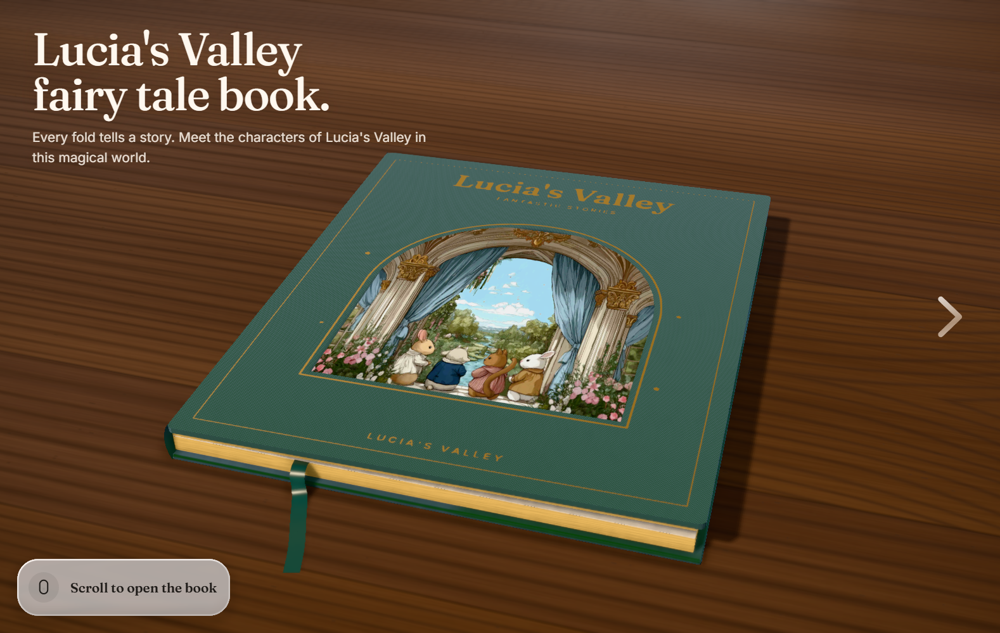
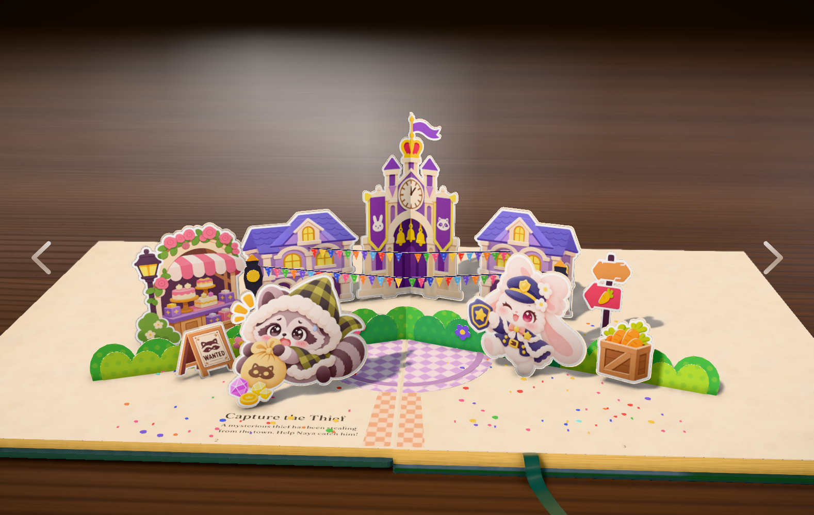
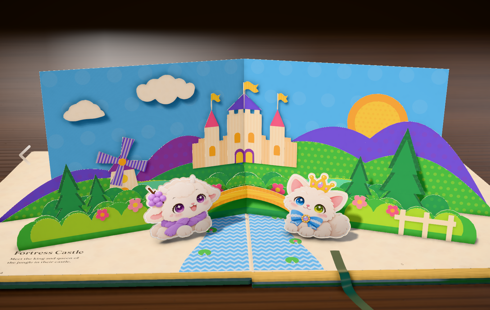

# Lucia's Valley

An interactive [Three.js](https://threejs.org) pop-up book. Paper scenes fold open in WebGL: bring a transparent PNG, or draw the paper in code. Scroll, drag a page, or use the arrows to turn.

Three.js · WebGL · creative coding · pop-up book · interactive storytelling

[中文说明](README.zh-CN.md)



The book is one cover plus two stories. Both stories are ordinary scene files. A scene is a list of cards. A card is either a picture or a shape you draw in code, and one page can hold both.

| Capture the Thief | Fortress Castle |
| --- | --- |
|  |  |

**Capture the Thief** (`src/scenes/square.js`) is the picture story. Houses, the clocktower, the bakery, the raccoon and Officer Naya are transparent PNGs. The garland, the lamps, the bushes and the confetti on the path are drawn paper.

**Fortress Castle** (`src/scenes/castle.js`) is the drawn story. Sky, hills, castle, bridge, trees, windmill and river are shapes. Luna the lamb and Reine the crown cat are pictures standing in front (`luna-lamb.png`, `crown-cat.png`). Drag the windmill sails and they spin.

## Run

```bash
npm install
npm run dev
```

Vite prints a local URL. The script asks for port 5199, and moves to the next free port if that one is taken.

```bash
npm run build     # static site in dist/
npm run preview   # serve that build
```

On the cover, the line at the bottom left stays until the first page turn. After that, scroll, drag, or the side arrows turn the pages. The previous arrow hides on the cover. The next arrow hides on the last page.

## How a page is built

A story exports one function, `buildSquare(api, base)` or `buildCastle(api, base)`. It returns the floor it was given, then a list of pieces. Each standing piece is a **v-strip**: a fold that rises off the gutter, with a card on the left page and a card on the right page.

```js
vstrip(name, at, leftCard, rightCard)
```

Coordinates on a card, in page units:

| | |
| --- | --- |
| `x = 0` | the spine. `x` grows toward the outer edge. A page is about 176 wide. |
| `y = 0` | the floor. `y` grows up. |
| `at` | depth along the gutter. Bigger stands closer to the reader. Negative sits toward the back. Houses and the clocktower use `-44`. The raccoon uses `80`. |

The left page is mirrored. A picture placed on the left comes out flipped. Anything with a facing direction, or with text, needs a pre-flipped file for the left half. The clocktower does this: `clocktowerL.png` is already flipped, `clocktowerR.png` is not, and the two halves meet at `x = 0` so the tower creases with the book.

```js
vstrip("clocktower", -44,
    card(0, 46, 122, clocktowerLUrl, 1, null),
    card(0, 46, 122, clocktowerRUrl, 1, null));
```

Keep the first four pieces of `base`. They are the floor and the path. Everything you add goes after them, back to front.

```js
pieces: [
    ...base.pieces.slice(0, 4),
    vstrip("houses", -44, leftHouses, rightHouses),
    vstrip("raccoon", 80, raccoonCard, blank()),
]
```

A strip wants a card on both sides. If a character only stands on one page, fill the other side with `blank()`.

The helpers on `api` are `P` (the palette), `shape`, `rect`, `circle`, `ellipse`, `panel`, `layer`, `flat`, `vstrip`, `star`, `deg`.

## Image cards

An image card is a transparent PNG stood on a hidden paper card. The opaque pixels are the cut-out, so a character, a shop or a sign needs no outline. Export the PNG with a transparent background. A white rectangle around the artwork will stand up as a white rectangle.

`square.js` wraps this in a small helper:

```js
const card = (x0, x1, y1, img, scale, hint) =>
    panel(P.cream, rect(x0, 0, x1, y1), [], [],
        img ? { image: img, imageScale: scale ?? 1, hideCard: true, hint } : {});
```

| Argument | Meaning |
| --- | --- |
| `x0`, `x1` | left and right of the card, measured from the spine |
| `y1` | how tall the card is. The bottom is always the floor (`y = 0`) |
| `img` | a URL from `import raccoonUrl from "../pics/placeholders/raccoon.png"` |
| `scale` | `imageScale`. `1` fits the picture to the card. `1.1` draws it a little larger |
| `hint` | `{ icon, text }`, or `null`. Shown while the pointer is over the piece |
| `hideCard` | hides the cream rectangle, so only the PNG is visible |

Put your file in `src/pics/` (or `src/pics/placeholders/`) and change the import. The card updates on the next reload. The town pictures today are `houses1.png`, `clocktowerL.png`, `clocktowerR.png`, `bakery.png`, `signpost.png`, `wanted.png`, `crate.png`, `barrel.png`, `raccoon.png` and `rabbit.png`.

The lamb and the cat in `castle.js` are the same kind of card, with the scale fixed at `1`:

```js
const card = (x0, x1, y1, img, hint) =>
    panel(P.cream, rect(x0, 0, x1, y1), [], [],
        img ? { image: img, imageScale: 1, hideCard: true, hint } : {});

vstrip("luciaPair", 76,
    card(22, 86, 60, lambUrl, { icon: "🐑", text: "Welcome to Lucia's Valley!" }),
    card(22, 86, 60, catUrl, { icon: "👑", text: "This valley is under my protection." }));
```

The cover window is a picture too, but it lies in the cloth instead of standing up. In `src/scenes/book.js`:

```js
import windowArt from "../pics/cover.jpg";

window: { w: 152, h: 160, image: windowArt, crop: 0.8 }
```

`crop` keeps the centre of the photo. `0.8` keeps the middle 80 percent. `1`, or leaving it out, shows the whole image. `{ x, y }` crops width and height separately. Set `image` to `null` and the window falls back to the built-in paper drawing.

## Drawn cards

A drawn card is a paper shape. There is no texture file. The colour is a name from `src/art/palette.js`, and an optional pattern is printed on top.

```js
const hill = panel(P.emerald, scallop(84, 0, 184, 34, 8), [], [], {
    color2: P.plum,
    pat: [2, 26, 0, 0.14], // dots
});

vstrip("ridge", 8, hill, hill);
```

`panel(color, outline, holes, layers, options)` is one piece of paper.

| | |
| --- | --- |
| `color` | a palette name, such as `P.emerald`, or a hex string |
| `outline` | a list of `[x, y]` points. `rect(x0, y0, x1, y1)` and `circle(x, y, r, segments)` build these. `scallop` in the scene files builds a bumpy hill or bush |
| `holes` | outlines cut out of the paper. `[]` when there are none |
| `layers` | extra shapes stacked on the same card. A door, a window, a flower |
| `color2` + `pat` | the printed pattern. `pat` is `[type, scale, angle, strength]` |

Pattern types: `1` stripes, `2` dots, `3` grid, `4` and `5` waves. `scale` is the spacing, `angle` is in radians, `strength` is how strongly the second colour shows. The sky in the valley is blue paper with pale dots. The bridge is yellow paper with stripes.

`layer(color, outlines, { z, color2, pat })` is one of those extra shapes. `z` is how far it sits off the card. A higher `z` draws in front. The windmill sails are a layer with a `spin` block, so dragging them rotates that one shape and leaves the tower still:

```js
{
    color: P.violet,
    z: 2.15,
    hint: { text: "Drag the sails to spin" },
    spin: { center: [cx, hubY], disc: fourSails(cx, hubY, 22, 2.3, 0.32), holes: [], layers: [], hangers: [] },
}
```

Changing a hex in `palette.js` recolours every piece that uses that name. Keep the existing keys (`emerald`, `marigold`, `cream`, …). Add a new key and use it as `P.yourName`. Mid, slightly warm colours read best. The book is lit by a studio HDRI, so a very dark or neon colour goes muddy.

Flat pieces lie on the page instead of standing up. The confetti in the town is `flat(name, side, outline, { color, layers })`, one sheet per colour, with `side` of `"L"` or `"R"`.

## Cover, table, and the words on the page

`src/scenes/book.js` is the closed book.

| Field | What it changes |
| --- | --- |
| `cover.title`, `subtitle`, `footer` | the foil stamped on the cloth |
| `cover.cloth` | fabric colour |
| `cover.foil` | foil colour |
| `cover.window` | the die-cut picture, described above |
| `body.pageEdge` | the stacked page edges |
| `body.ribbon` | the bookmark |

`src/scenes/desk.js` is the table. `base`, `grainLight` and `grainDark` are `[r, g, b]` from 0 to 255. `ambient` is the room behind the book, as a hex colour. `size.px` is the grain resolution. Higher is sharper and slower to build.

`src/scenes/catalog.js` is the page list. Order matters: the first entry is the cover, then one entry per story, in the same order as the scene list in the renderer. For a story, `name` is the title printed on the page and `line` is the sentence under it.

```js
{ id: "town", name: "Capture the Thief", line: "A mysterious thief has been stealing from the town. Help Naya catch him!" }
```

`id` is only a label. The book matches pages by position.

## Add a story

1. Copy `square.js` if the new page is mostly pictures, or `castle.js` if it is mostly drawn paper. Export `buildMarket(api, base)` (any name). Keep `...base.pieces.slice(0, 4)` so the floor stays, and return `{ name: base.name, thickness: base.thickness, pieces }`.

2. In `src/engine/engine.js`, import the function next to `buildSquare`, and append one call to the `of` list. Copy the helper object from the `buildCastle` call. Pass `NE` to start from the town floor, or `gT` to start from the valley floor. The leading `null` is the cover. Leave it.

```js
import { buildMarket } from "../scenes/market.js";

of = [
    null,
    buildSquare({ /* the same helper object */ }, NE),
    buildCastle({ /* the same helper object */ }, gT),
    buildMarket({ /* the same helper object */ }, gT),
]
```

3. Add a catalog entry in that same position.

```js
{ id: "market", name: "Market Morning", line: "The square wakes up." }
```

The catalog and `of` are matched by order. Four entries in the catalog means cover plus three stories, and `of` must be `null` plus three functions.

## Where to edit

| You want to change… | Open |
| --- | --- |
| Cover cloth, foil, titles, window photo | `src/scenes/book.js` |
| Page order, and the title and sentence on a page | `src/scenes/catalog.js` |
| The town | `src/scenes/square.js` |
| The valley | `src/scenes/castle.js` |
| Paper colours | `src/art/palette.js` |
| The table and the room | `src/scenes/desk.js` |
| Arrows, fonts, the cover headline, page background | `index.html` and the headline string in `src/engine/engine.js` |
| Pictures | `src/pics/` |
| Add or remove a whole story | the `of` list at the top and near the bottom of `src/engine/engine.js` |

`src/main.js` only starts the renderer. `src/engine/engine.js` folds the paper, lights it, and turns the pages. Day-to-day work stays in `src/scenes`, `src/art` and `src/pics`.

## Credit

The folding renderer is based on [Fold](https://github.com/iamtechartist/fold). The stories, the pictures and the colours are Lucia's Valley.
