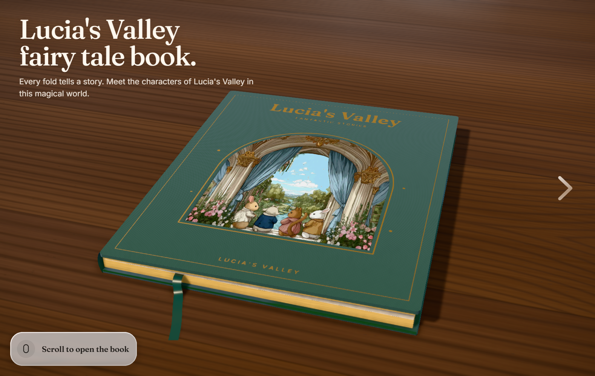
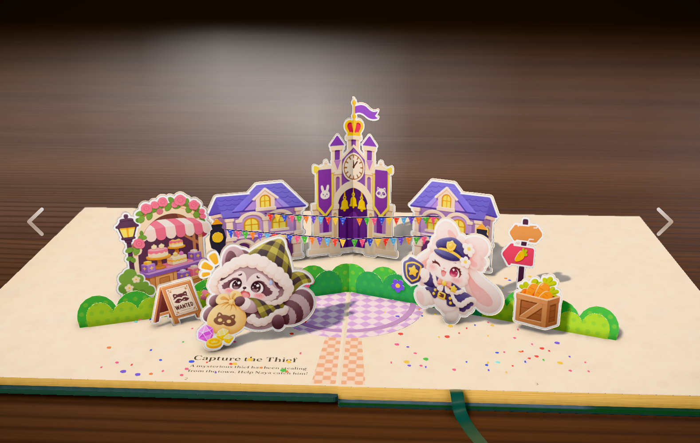
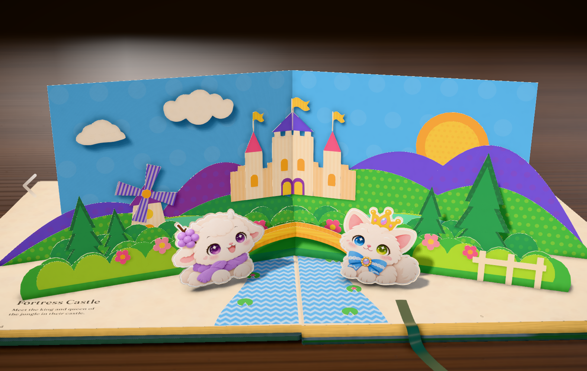

# 露西亚山谷

一本用 [Three.js](https://threejs.org) 做的交互立体书。纸页在 WebGL 里折开：放一张透明 PNG，或用代码把纸片画出来。滚动、拖动页面，或点两侧的箭头，都能翻页。

Three.js · WebGL · creative coding · 立体书 · 交互叙事

[English](README.md)

<video src="docs/demo.mp4" controls playsinline></video>

[播放演示](docs/demo.mp4)



整本书是一个封面加两个故事。两个故事都是普通的场景文件。一个场景就是一叠卡片。卡片可以是一张图片，也可以是用代码画出来的纸片，同一页上两种都能放。

| Capture the Thief | Fortress Castle |
| --- | --- |
|  |  |

**Capture the Thief**（`src/scenes/square.js`）是图片故事。房子、钟楼、面包店、浣熊和警官小兔 Naya 都是透明 PNG。彩旗、路灯、树丛，还有路上的碎纸屑，是画出来的纸。

**Fortress Castle**（`src/scenes/castle.js`）是绘制故事。天空、山丘、城堡、桥、树、风车和河都是形状。小羊 Luna 和皇冠猫 Reine 是立在前面的图片（`luna-lamb.png`、`crown-cat.png`）。拖动风车叶片，叶片会转。

## 运行

```bash
npm install
npm run dev
```

Vite 会在终端打印本地地址。脚本请求 5199 端口；如果被占用，会自动换到下一个空端口。

```bash
npm run build     # 静态站点输出到 dist/
npm run preview   # 预览这次构建
```

封面上，左下角那一行提示会一直留到第一次翻页。之后用滚轮、拖拽或两侧箭头翻页。封面没有上一页箭头，最后一页没有下一页箭头。

## 一页是怎么搭的

一个故事导出一个函数：`buildSquare(api, base)` 或 `buildCastle(api, base)`。它先留下传来的地面，再接上一串纸片。每一块立起来的纸片是一条 **v 折**：从书脊立起来，左页一块、右页一块。

```js
vstrip(name, at, leftCard, rightCard)
```

卡片上的坐标，单位就是页面自己的单位：

| | |
| --- | --- |
| `x = 0` | 书脊。`x` 向外侧长。一页大约宽 176。 |
| `y = 0` | 地面。`y` 向上长。 |
| `at` | 沿书脊的前后位置。越大离读者越近，负数靠后。房子和钟楼用 `-44`，浣熊用 `80`。 |

左页是镜像的。放在左边的图会左右翻转。有朝向的图，或者带字的图，左半边要事先翻转好。钟楼就是这样：`clocktowerL.png` 已经翻过，`clocktowerR.png` 没有，两半在 `x = 0` 拼上，合上书时从中间折起来。

```js
vstrip("clocktower", -44,
    card(0, 46, 122, clocktowerLUrl, 1, null),
    card(0, 46, 122, clocktowerRUrl, 1, null));
```

`base` 的前四块要留着，那是地面和小路。你加的东西都接在后面，从后往前排。

```js
pieces: [
    ...base.pieces.slice(0, 4),
    vstrip("houses", -44, leftHouses, rightHouses),
    vstrip("raccoon", 80, raccoonCard, blank()),
]
```

一条折页两边都要有卡片。角色只站在一边时，另一边用 `blank()` 补上。

`api` 上的工具有：`P`（调色板）、`shape`、`rect`、`circle`、`ellipse`、`panel`、`layer`、`flat`、`vstrip`、`star`、`deg`。

## 图片卡片

图片卡片是一张透明 PNG，立在一张藏起来的纸卡上。不透明的像素就是剪影，角色、店铺、告示牌都不用在代码里描边。PNG 要带透明背景。作品周围如果留着白底，立起来就是一块白纸。

`square.js` 把它收成一个小函数：

```js
const card = (x0, x1, y1, img, scale, hint) =>
    panel(P.cream, rect(x0, 0, x1, y1), [], [],
        img ? { image: img, imageScale: scale ?? 1, hideCard: true, hint } : {});
```

| 参数 | 含义 |
| --- | --- |
| `x0`, `x1` | 卡片左右边缘，从书脊量起 |
| `y1` | 卡片有多高。底边永远在地面（`y = 0`） |
| `img` | 一张图的地址，来自 `import raccoonUrl from "../pics/placeholders/raccoon.png"` |
| `scale` | `imageScale`。`1` 是图片刚好铺满卡片，`1.1` 稍微放大 |
| `hint` | `{ icon, text }`，或者 `null`。指针停在这块上时显示 |
| `hideCard` | 藏起那张米色底纸，只留下 PNG |

把文件放进 `src/pics/`（或 `src/pics/placeholders/`），改掉对应的 import，重新加载就换上了。小镇现在用的图是 `houses1.png`、`clocktowerL.png`、`clocktowerR.png`、`bakery.png`、`signpost.png`、`wanted.png`、`crate.png`、`barrel.png`、`raccoon.png`、`rabbit.png`。

山谷里的小羊和猫是同一种卡片，缩放固定为 `1`：

```js
const card = (x0, x1, y1, img, hint) =>
    panel(P.cream, rect(x0, 0, x1, y1), [], [],
        img ? { image: img, imageScale: 1, hideCard: true, hint } : {});

vstrip("luciaPair", 76,
    card(22, 86, 60, lambUrl, { icon: "🐑", text: "Welcome to Lucia's Valley!" }),
    card(22, 86, 60, catUrl, { icon: "👑", text: "This valley is under my protection." }));
```

封面窗口也是一张图，只是贴在封皮上，不立起来。在 `src/scenes/book.js` 里：

```js
import windowArt from "../pics/cover.jpg";

window: { w: 152, h: 160, image: windowArt, crop: 0.8 }
```

`crop` 保留照片的中心。`0.8` 是保留中间 80%。`1` 或不写，就是整张图。`{ x, y }` 可以分别裁宽度和高度。`image` 设成 `null` 时，窗口回到内置的纸片插画。

## 绘制卡片

绘制卡片是一块纸片形状，没有贴图。颜色是 `src/art/palette.js` 里的一个名字，还可以再印一层花纹。

```js
const hill = panel(P.emerald, scallop(84, 0, 184, 34, 8), [], [], {
    color2: P.plum,
    pat: [2, 26, 0, 0.14], // 圆点
});

vstrip("ridge", 8, hill, hill);
```

`panel(color, outline, holes, layers, options)` 是一张纸。

| | |
| --- | --- |
| `color` | 调色板名字，例如 `P.emerald`，也可以直接写十六进制颜色 |
| `outline` | 一串 `[x, y]` 点。`rect(x0, y0, x1, y1)` 和 `circle(x, y, r, segments)` 用来生成。场景文件里的 `scallop` 用来画起伏的山或树丛 |
| `holes` | 从纸上挖掉的轮廓。没有就写 `[]` |
| `layers` | 叠在同一张卡片上的小形状。一扇门、一扇窗、一朵花 |
| `color2` + `pat` | 印上去的花纹。`pat` 是 `[种类, 间距, 角度, 强度]` |

花纹种类：`1` 条纹，`2` 圆点，`3` 网格，`4` 和 `5` 波浪。`间距` 越大花纹越疏，`角度` 用弧度，`强度` 是第二种颜色有多明显。山谷的天空是带浅圆点的蓝纸，桥是带条纹的黄纸。

`layer(color, outlines, { z, color2, pat })` 是叠上去的一块。`z` 是它离卡片有多远，越大越靠前。风车叶片是一块带 `spin` 的层，拖动时只转叶片，塔身不动：

```js
{
    color: P.violet,
    z: 2.15,
    hint: { text: "Drag the sails to spin" },
    spin: { center: [cx, hubY], disc: fourSails(cx, hubY, 22, 2.3, 0.32), holes: [], layers: [], hangers: [] },
}
```

在 `palette.js` 里改一个色值，所有用到这个名字的纸片一起变。已有的键要留着（`emerald`、`marigold`、`cream` 这些）。可以加新键，然后写成 `P.yourName`。中等饱和、稍微偏暖的颜色最像纸。书是用棚拍环境光照的，太暗或太荧光的颜色会发闷。

平贴的纸片躺在页面上，不立起来。小镇的碎纸屑就是 `flat(name, side, outline, { color, layers })`，每种颜色一张薄片，`side` 用 `"L"` 或 `"R"`。

## 封面、桌子，和印在页面上的字

`src/scenes/book.js` 是合上的那本书。

| 字段 | 改的是什么 |
| --- | --- |
| `cover.title`、`subtitle`、`footer` | 烫在封皮上的字 |
| `cover.cloth` | 布面颜色 |
| `cover.foil` | 烫金颜色 |
| `cover.window` | 封面上的开窗图片，上面已经写过 |
| `body.pageEdge` | 书页叠起来的侧面 |
| `body.ribbon` | 书签丝带 |

`src/scenes/desk.js` 是桌子。`base`、`grainLight`、`grainDark` 是 0 到 255 的 `[r, g, b]`。`ambient` 是书后面的房间颜色，写十六进制。`size.px` 是木纹的精细程度，越大越清楚，生成也越慢。

`src/scenes/catalog.js` 是页码表。顺序不能乱：第一条是封面，后面每个故事一条，和渲染器里的场景列表对齐。故事的 `name` 是印在页面上的标题，`line` 是标题下面那一句。

```js
{ id: "town", name: "Capture the Thief", line: "A mysterious thief has been stealing from the town. Help Naya catch him!" }
```

`id` 只是个名字。书按位置对页，不按 id 对。

## 加一个故事

1. 新的一页如果主要是图片，就复制 `square.js`；如果主要是画出来的纸片，就复制 `castle.js`。导出 `buildMarket(api, base)`，名字随意。保留 `...base.pieces.slice(0, 4)`，地面才不会丢。返回 `{ name: base.name, thickness: base.thickness, pieces }`。

2. 在 `src/engine/engine.js` 里，跟 `buildSquare` 一起导入，再往 `of` 列表末尾加一次调用。辅助函数对象照抄 `buildCastle` 那一次。地面想从小镇开始，传入 `NE`；想从山谷开始，传入 `gT`。列表开头的 `null` 是封面，留着。

```js
import { buildMarket } from "../scenes/market.js";

of = [
    null,
    buildSquare({ /* 同一组辅助函数 */ }, NE),
    buildCastle({ /* 同一组辅助函数 */ }, gT),
    buildMarket({ /* 同一组辅助函数 */ }, gT),
]
```

3. 在目录的同一位置加一条。

```js
{ id: "market", name: "Market Morning", line: "The square wakes up." }
```

目录和 `of` 按顺序对应。目录有四条，就是封面加三个故事，`of` 就必须是 `null` 再加三个函数。

## 改哪里

| 想改什么 | 打开 |
| --- | --- |
| 封面布料、烫金、标题、窗口照片 | `src/scenes/book.js` |
| 页序，以及印在页面上的标题和那一句 | `src/scenes/catalog.js` |
| 小镇 | `src/scenes/square.js` |
| 山谷 | `src/scenes/castle.js` |
| 纸的颜色 | `src/art/palette.js` |
| 桌子和房间 | `src/scenes/desk.js` |
| 箭头、字体、封面大标题、页面背景 | `index.html`，大标题那一行在 `src/engine/engine.js` |
| 图片 | `src/pics/` |
| 增加或删掉一整页故事 | `src/engine/engine.js` 顶部的导入，以及靠后的 `of` 列表 |

`src/main.js` 只负责启动。`src/engine/engine.js` 负责折纸、打光和翻页。平时改故事，待在 `src/scenes`、`src/art` 和 `src/pics` 里就够了。

## 致谢

翻页渲染器基于 [Fold](https://github.com/iamtechartist/fold)。故事、图片和颜色是露西亚山谷的。
